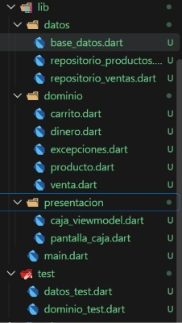
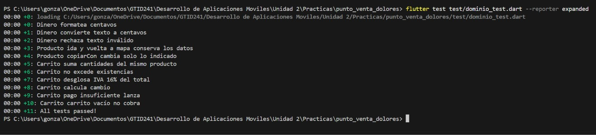
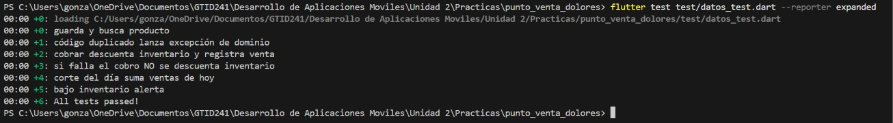
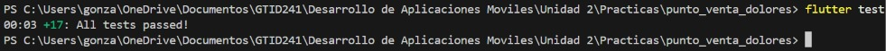
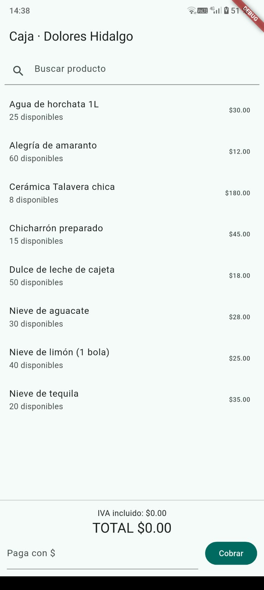
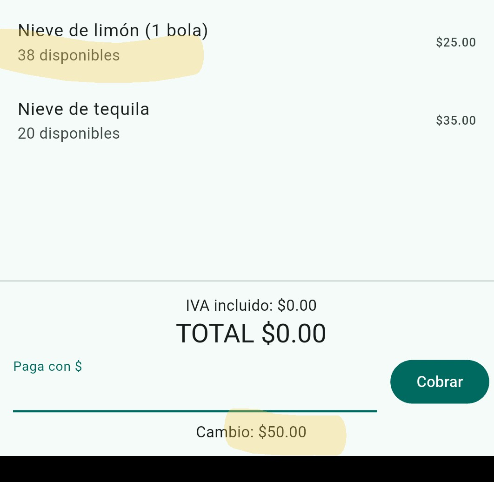
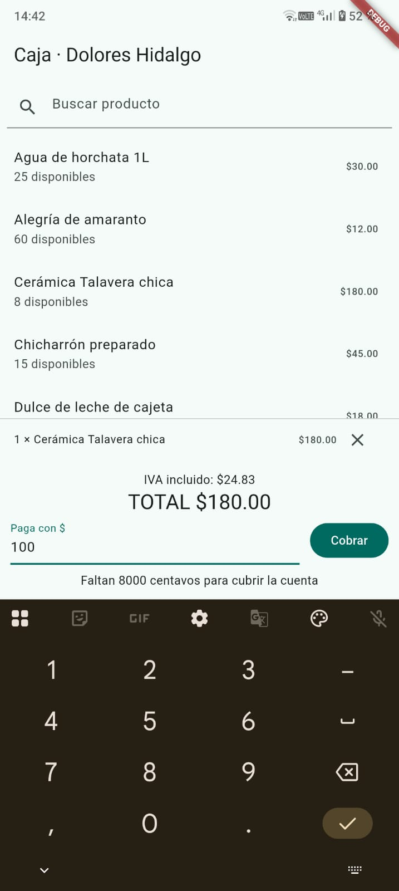
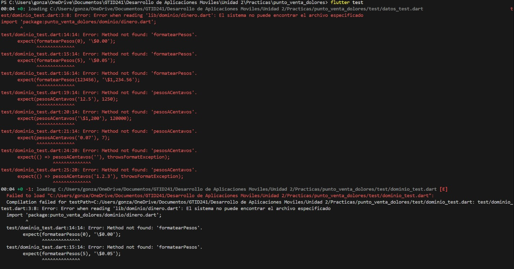

# Punto de Venta con TDD · Flutter + SQLite

**Materia:** Desarrollo Móvil Integral
**Universidad:** UTNG, Dolores Hidalgo
**Profesor:** Anastacio Rodríguez García
**Alumno:** González López Yael Isaac
**Fecha:** [fecha de entrega]

## Descripción

Punto de venta que guarda productos y ventas en una base de datos SQLite local (funciona sin internet). Calcula totales, IVA y cambio usando centavos enteros, descuenta el inventario al cobrar con una transacción y hace el corte del día. Se desarrolló con TDD (prueba en rojo, código en verde, refactor).

## Estructura del proyecto

```
lib/
  dominio/        reglas del negocio (dinero, producto, carrito, venta)
  datos/          SQLite (base de datos y repositorios)
  presentacion/   ViewModel y pantalla de caja
  main.dart
test/
  dominio_test.dart
  datos_test.dart
capturas/
```



## Cómo ejecutarlo

```
flutter pub get
flutter test
flutter run
```

## Pruebas realizadas

### 1. Pruebas de dominio (11 pruebas)

| Prueba | Qué verifica |
|---|---|
| Formatea centavos | 5 centavos se muestra como $0.05 y 123456 como $1,234.56 |
| Convierte texto a centavos | "12.5" da 1250 centavos |
| Rechaza texto inválido | "" y "1.2.3" lanzan error |
| Producto ida y vuelta a mapa | Los datos se conservan al guardar y leer |
| Producto copiarCon | Cambia solo lo indicado |
| Suma cantidades | Dos nieves forman una línea con cantidad 2 |
| No excede existencias | No deja agregar más de lo que hay |
| Desglose de IVA 16% | Con $100.00 el IVA es 1379 centavos y subtotal + IVA = total |
| Calcula cambio | Pago de $50.00 por una nieve de $25.00 da $25.00 de cambio |
| Pago insuficiente | Lanza excepción |
| Carrito vacío | No permite cobrar |



### 2. Pruebas de datos (6 pruebas)

| Prueba | Qué verifica |
|---|---|
| Guarda y busca producto | Se guarda en SQLite y se recupera por código |
| Código duplicado | Lanza CodigoDuplicadoException |
| Cobrar descuenta inventario | Las existencias bajan y se registra la venta |
| Cobro fallido no descuenta | Si el pago es corto, el inventario no cambia (transacción) |
| Corte del día | Suma el total de las ventas de hoy |
| Bajo inventario | Detecta productos con pocas existencias |



### 3. Todas las pruebas juntas



## Evidencia de la aplicación

### Catálogo de productos


### Cobro exitoso
Dos nieves de limón, pago de $100.00, cambio de $50.00 y existencias de 40 a 38.



### Pago insuficiente


## Ciclo TDD (opcional)

Captura de una prueba en ROJO antes de crear el código:




